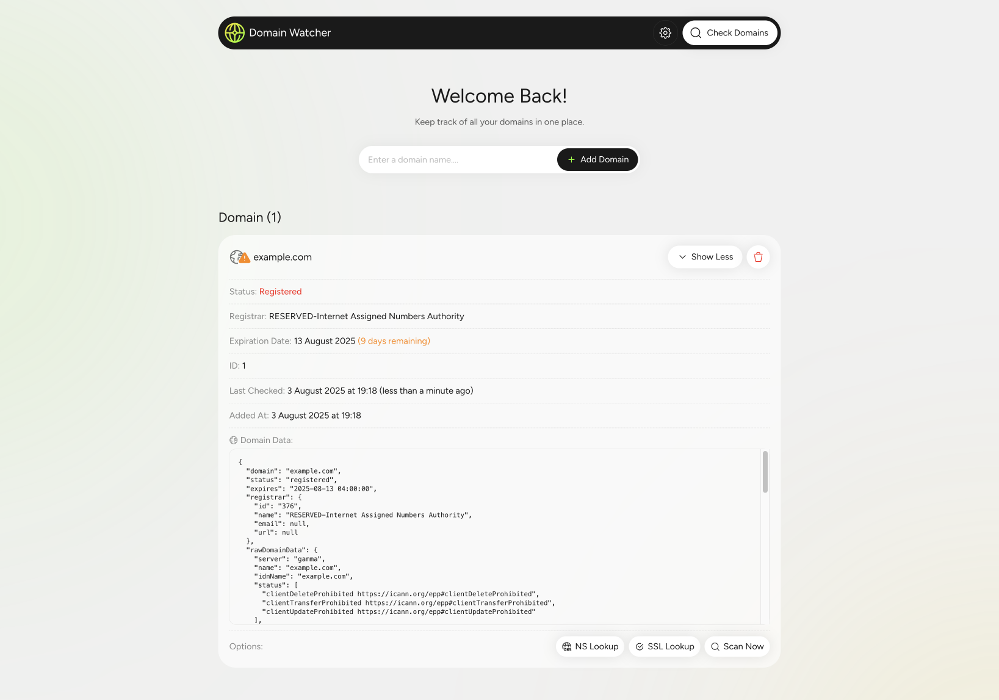
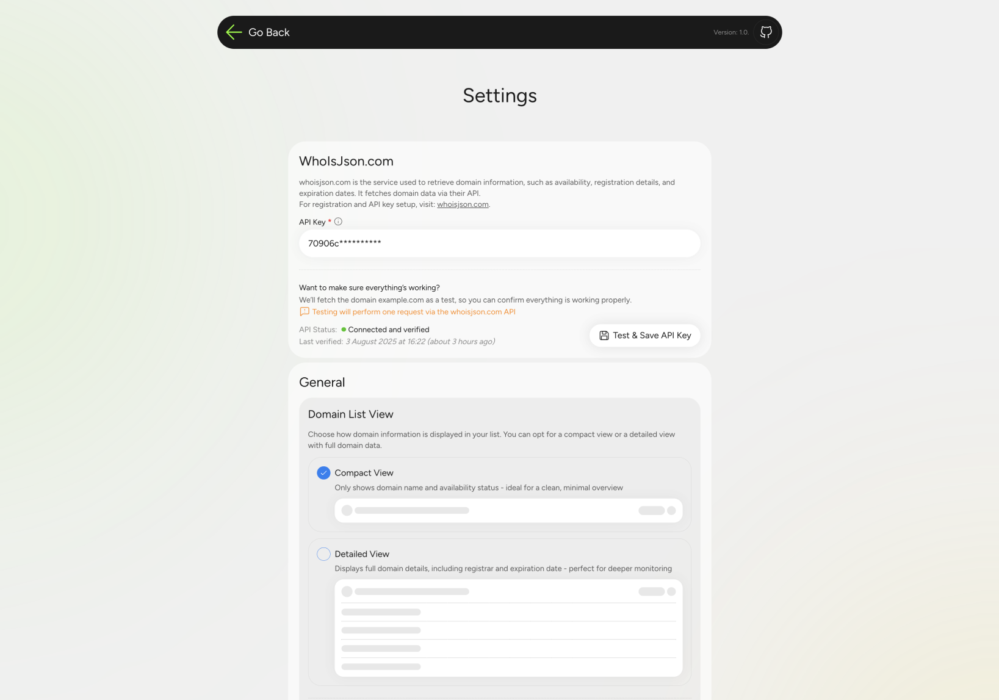
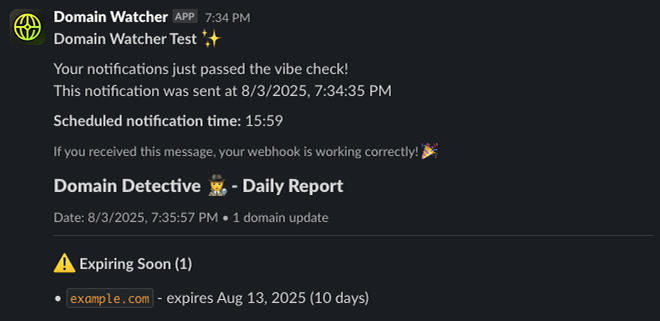
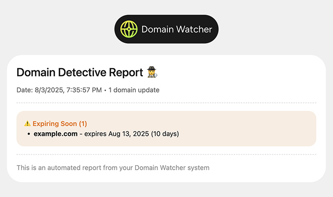

# Domain Watcher | Domain Availability Monitor & Expiration Tracker


**Keywords:** `domain monitor` • `domain checker` • `whois lookup` • `ssl certificate tracker` • `domain expiration alerts` • `sveltekit` • `cloudflare workers` • `slack notifications` • `discord notifications` • `resend notifications` • `email notifications`

## 🔗 [Check Live Demo](https://domain-watcher.klemenc.dev)

> **Monitor domain availability, track expiration dates, and get notifications when domains become available or are about to expire.**

A modern **domain monitoring tool** built with SvelteKit and Cloudflare Workers that tracks domain availability, SSL certificates, and sends smart notifications via Slack, Discord or email (Resend).

**Perfect for:** Domain investors, web developers, businesses tracking competitor domains, and anyone managing domain portfolios.

### Tech Stack

-   **Frontend**: SvelteKit
-   **Platform**: Cloudflare Workers
-   **Database**: Cloudflare D1 (SQLite)
-   **Notifications**: Slack Webhooks, Discord Webhooks, Resend API
-   **Scheduling**: Cloudflare Cron Triggers
-   **Domain Data**: RDAP (free, no API key, default) with optional WhoisJSON (1000 free calls/month) as a selectable provider and fallback; NS lookups via Cloudflare DNS-over-HTTPS

---

## Table of Contents

-   [👀 Overview](#-overview)
-   [🚀 Features](#-features)
-   [📦 Setup](#-setup)
-   [🛠️ Development](#️-development)
-   [🌐 Deployment](#-deployment---via-cloudflare-with-github-integration)
-   [🔒 Protect Your Deployment](#-protect-your-deployment)
    -   [Upgrading an Existing Deployment](#upgrading-an-existing-deployment)
-   [🗃️ Database Schema](#️-database-schema)
-   [🐛 Troubleshooting](#-troubleshooting)
-   [Contributing](#contributing)

---

## 👀 Overview

A SvelteKit application running on Cloudflare Workers that monitors domain availability and sends notifications via Slack, Discord or Email (Resend) when domains become available.

In addition to available domains, you also receive:

-   A list of domains that are expiring within 30 days
-   A list of domains that have already expired but are still registered

A daily summary keeps you informed and helps you act fast.

#### App Overview



#### Settings Page



#### Slack Notification



#### Email Notification



---

## 🚀 Features

-   **Domain Monitoring**: Monitor domain status, including availability, nameservers (NS), and SSL certificate validity. Only registrable domains can be added (`example.com`, `example.co.uk`) - subdomains like `www.example.com` or `foo.github.io` are rejected, because registries don't track them and they would read as "available".
-   **Automated Checks**: A cron job runs every minute to evaluate if notification conditions are met (via Slack, Discord or Resend), based on the configured time and settings.
-   **Notifications via Slack, Discord or Email (Resend)**: Get notified when domains become available or when specific conditions are met. Choose your preferred notification method (Slack, Discord or Email) and configure when alerts should be sent.
-   **Domain Lookup Providers**: Choose between RDAP (free, queries domain registries directly, no API key needed) and WhoisJSON. With RDAP selected, TLDs without a public RDAP server (.eu, .co, .at, .it, .es, .us, .hr, .rs) fall back to WhoisJSON when an API key is configured and the "Allow WhoisJSON fallback" toggle is on (default). Every domain card shows which provider was used and which one the next check will use. SSL certificate checks always require a WhoisJSON API key; NS lookups run via Cloudflare DNS-over-HTTPS and need no key.
-   **Settings Panel**: Pick the domain lookup provider, configure the optional WhoisJSON API key, choose your preferred view mode for the interface, and manage notification settings for Slack, Discord and Resend.
-   **Web Interface**: A clean and functional UI where you can add new domains, view and manually refresh domain status, perform bulk checks, and manage your domain list with ease.
-   **Password Protection**: The whole app sits behind a browser login prompt (`ADMIN_PASSWORD`), see [Protect Your Deployment](#-protect-your-deployment).

## 📦 Setup

### Prerequisites

-   Node.js 22.17+ (required by SvelteKit 3) and pnpm 10 or 11 - `pnpm install` refuses older Node.js versions (`engine-strict`)
-   [Cloudflare Account](https://www.cloudflare.com/)
-   [WhoIs JSON API key](https://whoisjson.com) - Optional: only needed for SSL certificate checks, the WhoisJSON provider, or TLDs without a public RDAP server (.eu, .co, .at, .it, .es, .us, .hr, .rs). Domain checks work out of the box via RDAP without any key.
-   [Slack Webhooks](https://api.slack.com/messaging/webhooks) – Create a Slack app and generate an incoming webhook URL for Slack notifications
-   [Discord Webhooks](https://support.discord.com/hc/en-us/articles/228383668-Intro-to-Webhooks) – Create a webhook in your Discord channel settings (Integrations → Webhooks) for Discord notifications
-   [Resend API](https://resend.com/docs/dashboard/api-keys/introduction) – Generate your Resend API key to enable email notifications

---

## 🛠️ Development

### Local Development Setup

1. **Install Dependencies**

    ```bash
    pnpm install
    ```

2. **Environment Configuration**

    Create a local `.env` file by duplicating the example:

    ```bash
    # Copy the example environment file
    cp .env.example .env
    ```

    Then edit `.env` with your specific values:

    ```bash
    PUBLIC_ENVIRONMENT=dev
    PUBLIC_TIMEZONE=Europe/Ljubljana
    CRON_SECRET=dev-super-secure-key
    PRODUCTION_DOMAIN=https://your-app.com
    ALLOW_ROBOTS=false
    # ADMIN_PASSWORD=your-local-password   # Optional for `pnpm run dev`, required for `pnpm preview`
    ```

    > 🔒 `ADMIN_PASSWORD` is optional with `pnpm run dev`: without it the app is open and a warning is logged. Set it to try the browser login prompt locally (see [Protect Your Deployment](#-protect-your-deployment)).

3. **Local Database Setup**

    Create and configure your local development database:

    ```bash
    # Creation of DB and applying schema to local database
    npx wrangler d1 execute local-domain-watcher --local --file=./schema.sql
    ```

    > 📝 **Note**: `schema.sql` is safe to re-run - it never drops tables or overwrites existing rows, it only creates what is missing (the two sample domains are added again only if they no longer exist).

4. **Verify Database Setup**

    Check that your database was created successfully:

    ```bash
    # Verify local database connection
    npx wrangler d1 execute local-domain-watcher --local --command="SELECT * FROM domains;"
    ```

    _Expected output: Existing test data_

5. **Start Development Server**

    Launch the local development server:

    ```bash
    # Start development server
    pnpm run dev
    ```

    Your application will be available at: http://localhost:5173

### Local Build

Runs the production build in the local Cloudflare Workers runtime (`wrangler dev`), including the cron handler.

1. **Build the application** (required first - `pnpm preview` serves the output of the last build):

    ```bash
    pnpm run build
    ```

2. **Start the local Workers runtime with cron testing enabled**:

    ```bash
    # Runs `wrangler dev --test-scheduled` on http://localhost:8787
    pnpm preview
    ```

> 🔑 **Secrets in `wrangler dev`**: `wrangler dev` reads `CRON_SECRET` and `ADMIN_PASSWORD` from the same `.env` file as `pnpm run dev` (if a `.dev.vars` file exists, it is used instead and `.env` is ignored - never commit it). The cron handler and `/api/cron` both read this one value, so there is nothing to keep in sync. A build is not the dev server, so **`ADMIN_PASSWORD` is required here** - without it every page responds with 503.

### Icons

Icons come from the [iconoir](https://icon-sets.iconify.design/iconoir/) set and are bundled with the app (no requests to the Iconify API at runtime, icons are part of the server-rendered HTML). Only the icons used in `src/` end up in `src/lib/icons/iconoir.json`:

-   Write icon names as full literals, e.g. `icon="iconoir:globe"` - a dynamically built name can't be bundled and fails the generator
-   The subset is regenerated automatically before `pnpm run dev` and `pnpm run build`; run `pnpm icons` manually after adding an icon (and commit the updated JSON), or `pnpm icons:check` to verify it is up to date

### Useful Commands

-   `pnpm run dev` - Vite dev server on http://localhost:5173
-   `pnpm run build` - production build, including the cron handler (`postbuild`)
-   `pnpm preview` - runs the last build with `wrangler dev --test-scheduled` on http://localhost:8787
-   `pnpm check` - type-checks the project with `svelte-check` (`pnpm check:watch` keeps it running)
-   `pnpm icons` / `pnpm icons:check` - regenerates / verifies the bundled icon subset

### Testing Cron Jobs Locally

#### Manual Trigger

With `pnpm preview` running (`pnpm run dev` has no scheduled handler), visit the following URL to fire the cron trigger once:

```
http://localhost:8787/__scheduled?cron=*+*+*+*+*
```

#### Expected Console Output

```
🚀 Starting cron...
🕐 Check at: 2026-10-18 21:23 (Europe/Ljubljana)
```

> 📝 **Note**: `/__scheduled` follows the normal schedule, so a report is only sent when a provider is due (see [Cron Schedule](#cron-schedule)) - the log explains every skipped provider. To send right away, call the endpoint with `{"manual": true}` (below). "✅ Local - Self-call completed successfully!" means `/api/cron` answered with a 2xx status (any other status logs "❌ Cron request failed").

#### Call the Endpoint Directly

`/api/cron` is not behind `ADMIN_PASSWORD`, it is protected by the `x-cron-secret` header. The `Content-Type: application/json` header is required - SvelteKit rejects POST requests without it as cross-site (403):

```bash
# Use port 5173 with `pnpm run dev`, 8787 with `pnpm preview`
curl -X POST http://localhost:5173/api/cron \
     -H "x-cron-secret: your-secret-here" \
     -H "Content-Type: application/json" \
     -d '{"manual": true}'   # Optional: bypasses the schedule and runs immediately
```

When `CRON_SECRET` is not configured, the endpoint rejects every request with 503. In production, call `https://your-app.com/api/cron` the same way, e.g. to send a report the 60-minute window missed (a manual run sends to every enabled provider) - Cloudflare can't show a secret after it is set, so keep the `CRON_SECRET` value (e.g. in your password manager) if you want to call it by hand. `GET /api/cron` returns a small health JSON without any secret, handy for uptime monitors.

### Cron Schedule

The cron job runs **every minute** to check scheduled notifications. Since you can set specific times in Slack, Discord or Resend settings (e.g., "Send at 14:30"), the cron job must check every minute to trigger notifications at the scheduled time.

**Example**: If notification is set for 14:30, the daily report goes out at 14:30 (in `PUBLIC_TIMEZONE`).

How the schedule behaves:

-   **Once per day per provider**: the report is sent at the notification time or up to **60 minutes later**. A failed send (e.g. Slack temporarily down) or a missed cron tick is retried every minute within that hour; retries reuse the stored domain state instead of checking every domain again. If the hour passes without a successful send, that day's report is skipped (the log says "today's report was missed") - send it with a manual run (it sends to every enabled provider, not only the one that missed).
-   **DST safe**: a time skipped by the spring-forward jump fires right after it, the repeated hour in autumn sends only once.
-   **No duplicates**: overlapping cron runs can't send the same report twice (the daily slot is claimed in D1). Manual runs (`{"manual": true}`) always send and don't affect the schedule.
-   **Changing the time**: a new time that is still ahead today sends today's report at the new time, even if one already went out earlier today. A new time that passed up to 60 minutes ago sends today's report within a minute (unless it was already sent today). A provider without schedule state yet - saved for the first time, or not sent by the scheduler since the upgrade - that is saved with a time that already passed today starts tomorrow.
-   **`PUBLIC_TIMEZONE`** must be a valid IANA zone (e.g. `Europe/Ljubljana`) - an invalid value falls back to UTC with a warning in the logs.

Which domains are checked when a report is due:

-   At most **20 domains per run** (stays within the Workers Free subrequest limit), most urgent first: expired-but-registered and never-checked domains, then everything else in round-robin by last check time, so every domain is eventually covered. With more than 20 due domains a full pass takes several reports. The cap is `LIMIT_DOMAIN_CHECKS` in `src/lib/server/utils/domain-utils.js` (it also limits the manual bulk check) and can be raised on Workers Paid.
-   Registered domains are re-checked **daily** inside the 30-day expiry window or while the registry reports a grace/deletion state (redemption, pending delete, auto-renew), and **weekly** otherwise - so renewals and domains dropped after a registry auto-renew are noticed.
-   Domains checked in the last 12 hours are skipped on scheduled runs (a second provider later the same day reuses the fresh results).
-   Domains are only checked automatically when a provider's report is due - without an enabled notification provider, use the check buttons in the app.

---

## 🌐 Deployment - Via Cloudflare with GitHub Integration

Deploy your application using Cloudflare Worker with GitHub integration.

### Step 1: Database Setup (Production)

> ⚠️ Important: Complete database setup before deploying your application!

#### 1.1. Create Production Database

```bash
# Connect to CF account, create the production database and add it to wrangler.jsonc
npx wrangler d1 create prod-domain-watcher --env production --binding DB
```

#### 1.2. Update Database Configuration

With `--env production --binding DB`, Wrangler writes the new `database_id` into the `DB` binding under `env.production.d1_databases` in your [wrangler.jsonc](wrangler.jsonc) and leaves your local database alone. Without these flags Wrangler offers to add the binding itself (default **Yes**) and writes it into the top-level, local-only `d1_databases` - answer **No** (or remove what it added there) and copy the printed values under `env.production.d1_databases` yourself:

```jsonc
"d1_databases": [
    {
        "binding": "DB",
        "database_name": "prod-domain-watcher",
        "database_id": "generated-id"
    }
]
```

#### 1.3. Apply Database Schema

```bash
# Apply schema to production database
npx wrangler d1 execute prod-domain-watcher --remote --file=./schema.sql
```

#### 1.4. Verify Database Setup

```bash
# Check if tables were created successfully
npx wrangler d1 execute prod-domain-watcher --remote --command="SELECT * FROM domains;"
```

### Step 2: Create Cloudflare Worker Project:

**1. Go to Cloudflare Dashboard**:

-   Navigate to **Workers & Pages** under Compute (Workers)
-   Click **Create** → **Workers**
-   Select **Connect to Git**

**2. Import Repository**:

-   Choose your repository (e.g., "domain-watcher")
-   Name the Worker **`domain-watcher`**: it must match `env.production.name` and the `SELF` service binding (`services[].service`) in [wrangler.jsonc](wrangler.jsonc), and `npx wrangler secret put … --env production` writes to that name. To use another name, change both in `wrangler.jsonc` first - otherwise the cron self-call misses the Worker and the secrets land on a different one (your app keeps answering 503).

### Step 3: Build Configuration:

-   **Build command**: `pnpm run build`
-   **Deploy command**: `npx wrangler deploy --env production`
-   **Non-production branch builds**: keep them off, or set their command to `npx wrangler versions upload --env production`. The default command doesn't pass `--env production`, so it would use the local-only top-level config (placeholder database). Note that versions uploaded with `--env production` use the production database and secrets, so their preview URLs run branch code against your real data.
-   **Node.js**: the Workers Builds default works. If you pin a version (`NODE_VERSION` build variable, `.nvmrc` or `.node-version`), it must be 22.17 or newer, otherwise `pnpm install` fails with `ERR_PNPM_UNSUPPORTED_ENGINE`.
-   **Build variables**:

    Set these environment variables (update timezone and domain). They are inlined into the app at build time and **all four are required** - if one is missing (even `ALLOW_ROBOTS`), the build fails with "Invalid environment variables ... Value is missing". Changing one needs a new build.

    ```bash
    PUBLIC_ENVIRONMENT = production
    PUBLIC_TIMEZONE = Europe/Ljubljana         # Change to your timezone (e.g., America/New_York, UTC)
    PRODUCTION_DOMAIN = https://your-app.com   # Live application URL (no trailing slash) for email assets and robots.txt control
    ALLOW_ROBOTS = false                       # Set to true ONLY when ready for search engine indexing
    ```

> ⚠️ **Important**: `CRON_SECRET` and `ADMIN_PASSWORD` are **runtime secrets**, not build variables - don't add them here or to [`wrangler.jsonc`](wrangler.jsonc). Set them once with `npx wrangler secret put` (see [Step 5](#step-5-set-runtime-secrets)). The cron handler and `/api/cron` both read the same secret, so there is no value to keep in sync.

### Step 4: Create & Deploy

-   Push to Repository: Commit and push your changes to trigger automatic deployment
-   Monitor Build: Check build logs in the Cloudflare dashboard under **Workers & Pages > domain-watcher > Deployments**
-   Verify Deployment: Visit your deployed URL - until [Step 5](#step-5-set-runtime-secrets) is done it answers with 503 on purpose

### Step 5: Set Runtime Secrets

```bash
# Password for the browser login prompt (see Protect Your Deployment below)
npx wrangler secret put ADMIN_PASSWORD --env production

# Secret for the cron job - a secure random string (32+ characters), e.g. `openssl rand -hex 32`
npx wrangler secret put CRON_SECRET --env production
```

Wrangler prompts for each value. Secrets take effect immediately (no rebuild needed) and are kept across deploys.

### Post-Deployment Setup (if needed)

**Set Environment Variables** in Cloudflare Worker Dashboard:

-   **Build variables**: go to **Settings > Build > Variables and Secrets** and add `PUBLIC_ENVIRONMENT`, `PUBLIC_TIMEZONE`, `PRODUCTION_DOMAIN` and `ALLOW_ROBOTS` (changes need a new build)
-   **Runtime secrets**: `CRON_SECRET` and `ADMIN_PASSWORD` - use `npx wrangler secret put <NAME> --env production`, or go to **Settings > Variables and Secrets** and add them with type **Secret** (plain-text variables added there are overwritten by the next `wrangler deploy`)

---

## 🔒 Protect Your Deployment

Domain Watcher has no user accounts. Anyone who can open your URL could delete domains, turn off notifications or read the stored API keys, so the whole app (pages, data requests and remote functions) is protected with **HTTP Basic Auth** using the `ADMIN_PASSWORD` runtime secret.

1. **Set the password** (Wrangler prompts for the value):

    ```bash
    npx wrangler secret put ADMIN_PASSWORD --env production
    ```

2. **Use a strong password** - a long random one, e.g. `openssl rand -base64 24`. There is no rate limiting on login attempts, and a password manager can store it for the login prompt.

3. **Log in**: the browser shows its built-in login prompt. Any username works, only the password is checked. The browser remembers it until you close it.

4. **Change the password**: run `npx wrangler secret put ADMIN_PASSWORD --env production` again. It takes effect immediately (no rebuild), and browsers that remembered the old password show the login prompt again.

Good to know:

-   **Fails closed**: if `ADMIN_PASSWORD` is missing, the deployed app answers every request with 503 instead of being left open. Only `pnpm run dev` allows access without it (with a warning in the console).
-   **Always reachable**: `/api/cron` (protected by `CRON_SECRET` instead - the scheduled self-call sends no browser credentials), `/robots.txt` and static files (images, favicon, JS/CSS bundles), which contain no data.
-   **HTTPS only**: Basic Auth sends the password with every request, so plain HTTP requests are redirected to HTTPS before the login prompt. For custom domains also enable **SSL/TLS > Edge Certificates > Always Use HTTPS** (and optionally HSTS) in the Cloudflare dashboard.
-   **Demo mode is public**: with `PUBLIC_ENVIRONMENT = demo` the password is ignored, because the demo is a read-only public showcase. Never store real API keys or webhooks in a demo deployment.

### Upgrading an Existing Deployment

Earlier versions had no login and kept `CRON_SECRET` as a build variable and a plain-text `vars` entry in `wrangler.jsonc`. When upgrading:

1. **Set the admin password first** - the old version ignores it, so the new one never answers 503:

    ```bash
    npx wrangler secret put ADMIN_PASSWORD --env production
    ```

2. **Update `wrangler.jsonc`, then deploy this version** (push to trigger the build). Keep your own `database_id`, but remove every `"vars"` block with `CRON_SECRET` (top-level and under `env.production`) - otherwise the deploy keeps the old plain-text variable and step 3 fails. If your build settings pin Node.js (`NODE_VERSION` build variable, `.nvmrc` or `.node-version`), raise it to 22.17 or newer first, otherwise the build fails with `ERR_PNPM_UNSUPPORTED_ENGINE`.
3. **Then set a new cron secret**. It can only be set after that deploy, because until then the old plain-text `CRON_SECRET` variable occupies the name. Use a **new** random value (e.g. `openssl rand -hex 32`): earlier setups kept it in `wrangler.jsonc` and a build variable, and the template value `strong-secret-key-here` is public. Until it is set, the cron endpoint rejects every call.

    ```bash
    npx wrangler secret put CRON_SECRET --env production
    ```

4. **Remove the old `CRON_SECRET` build variable** under **Settings > Build > Variables and Secrets** (it is no longer used).
5. **Check your watchlist for subdomains** (e.g. `www.example.com`): they can no longer be added, and existing ones are marked as errors ("Enter the registrable domain ...") on their next check instead of being reported as available - remove them and add the registrable domain instead.
6. **Check your webhook URLs**: they are re-checked before every send - Slack must be `https://hooks.slack.com/services/…`, Discord `https://discord.com/api/webhooks/…` (discordapp.com and the ptb./canary. hosts also work). A stored URL that doesn't pass is skipped with only a log line ("enabled but not configured"), so replace it in Settings and send a test message.
7. **Local checkout**: switch to Node.js 22.17+ and run `pnpm install`. The local `CRON_SECRET` no longer comes from `wrangler.jsonc` - add it to `.env`, together with `ADMIN_PASSWORD` (required for `pnpm preview`). If you changed the code: `svelte.config.js` moved into the `sveltekit()` plugin in `vite.config.js`, and `$lib`, `$components` and `$src` imports are now `#lib`, `#components` and `#src`; the unused `$home` alias was removed (SvelteKit 3 fails the build on `$lib`).

No database migration is needed: the tables are unchanged, and the new schedule state (`last_sent_on`, `last_attempt_on`) is stored in each provider's settings automatically. Re-running the current `schema.sql` is harmless (it only re-adds the sample domains if you deleted them), but ⚠️ never run a `schema.sql` from an older checkout against production - it started with `DROP TABLE` and wipes all domains and settings.

On the day of the upgrade a provider whose notification time passed less than an hour before the deploy may send that day's report a second time - the new schedule state starts empty.

---

## 🗃️ Database Schema

The application uses two main tables:

`domains` Table

-   Stores domain names and availability status
-   Tracks domain expiration dates and check history
-   Stores complete provider responses (RDAP or WhoisJSON domain data with a `source` tag, DNS-over-HTTPS records, WhoisJSON SSL data)
-   Includes error logging and check statistics

`settings` Table

-   Category-based configuration storage (api, ui, notifications)
-   JSON-based config data for flexible settings management
-   Handles API credentials, UI preferences, and notification settings
-   Supports enabled/disabled states for notification services

For detailed table structure and relationships, see [schema.sql](schema.sql). The schema is safe to re-run on an existing database - it never drops tables or overwrites data (only the two sample domains are added back if you deleted them).

---

## 🐛 Troubleshooting

### Common Issues

1. **"Database not found"**: Ensure you've created the database and updated the `database_id` in `wrangler.jsonc`
2. **Build fails with "Invalid environment variables ... Value is missing"**: one of the build variables `PUBLIC_ENVIRONMENT`, `PUBLIC_TIMEZONE`, `PRODUCTION_DOMAIN` or `ALLOW_ROBOTS` is not set. Add it under **Settings > Build > Variables and Secrets** (locally: in `.env`) and rebuild. The runtime secrets `CRON_SECRET` and `ADMIN_PASSWORD` are not needed for the build - set them with `npx wrangler secret put <NAME> --env production`
3. **Cron jobs not working**: Check that the `CRON_SECRET` secret exists (`npx wrangler secret list --env production`). The logs show "CRON_SECRET is not configured" when it is missing. It must not be set in `wrangler.jsonc` or as a build variable
4. **Cron jobs not working locally**: Run `pnpm run build` and then `pnpm preview` (`wrangler dev --test-scheduled`), make sure `CRON_SECRET` is set in `.env` and test via the `/__scheduled` endpoint
5. **Every page responds with 503 "Domain Watcher is locked"**: `ADMIN_PASSWORD` is not set. Set the secret with `npx wrangler secret put ADMIN_PASSWORD --env production` (locally for `pnpm preview`: add `ADMIN_PASSWORD` to `.env`)
6. **The login prompt keeps coming back**: Any username works, but the password must match `ADMIN_PASSWORD` exactly. To log out, close the browser

### Debugging

-   Check logs in the Cloudflare dashboard under **Workers & Pages > domain-watcher > Observability** (Workers Logs are enabled in `wrangler.jsonc`), or stream them live with `npx wrangler tail --env production`. A cron run is marked as failed when `/api/cron` answers non-2xx: 503 (`CRON_SECRET` missing, or a report slot couldn't be claimed), 502 (every provider failed - retried within the hour) or 500 (unexpected error)
-   Use `console.log` statements in your code for debugging
-   Test API endpoints manually using curl or browser developer tools

### Check if your database is set up correctly:

```bash
### LOCAL ###
# Check database
npx wrangler d1 execute local-domain-watcher --local --command="SELECT * FROM domains";

# Check database structure
npx wrangler d1 execute local-domain-watcher --local --command="PRAGMA table_info(domains);"

# Export database backup
npx wrangler d1 export local-domain-watcher --local --output=backup.sql


### PRODUCTION ###
# Check production database
npx wrangler d1 execute prod-domain-watcher --remote --command="SELECT * FROM domains";

# Check database structure
npx wrangler d1 execute prod-domain-watcher --remote --command="PRAGMA table_info(domains);"
```

## Contributing

1. Fork the repository
2. Create a feature branch
3. Make your changes
4. Run `pnpm check` and `pnpm icons:check`, then test locally with `pnpm run build` and `pnpm preview`
5. Submit a pull request
